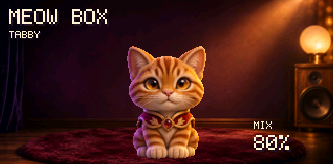

# Meow Box

拨一下弦，屏幕上的猫就跟着叫。转上方旋钮，声音会从小猫变成狮子。

## 配套音频包

先安装音频包，再安装 App。

- Meow Voice `org.resona.creative.meow-box.voice` 1.0.3

## 两个编码器

| 页面／模式 | 上方旋转 | 上方短按 | 上方长按 | 下方旋转 | 下方短按 | 下方长按／按住 |
| --- | --- | --- | --- | --- | --- | --- |
| Meow Box | 小猫→猫→狮子的音色 | 切换短／中／长喵叫 | 无功能 | 调吉他与喵声的混合比例 | 呼噜声开／关 | 长按重置 |

## 项目详细说明

# Meow Box

A cat sings whatever you play. Every note you pick comes back as a meow at that pitch. The sound is the nested `dsp/` pack (**Meow Voice**); the App is the cat and its room.

## Controls

| Control | Turn | Click | Long press |
|---|---|---|---|
| SELECTOR (top) | SIZE: kitten, cat, lion | meow length: MEW, MEOW, MEEOOOW | |
| CUSTOMIZE (bottom) | MEOW mix | purr on/off | reset |

Settings are saved. Purr starts off; click CUSTOMIZE to turn it on when wanted.

## Controller

`controller/` holds a Web controller (the Resona Box website's look) and a Mobile one (the Creator Lab app's look). Any MIDI controller can play Meow Box too: every control is one CC on channel 1, over USB, Bluetooth or the MIDI jack. CC 119 asks the App for every value; it then reports changes, including ones made with the knobs, and the input and output meters on CC 116 and 117.

The controllers add three hold pads and an XY surface (SIZE across, MEOW mix up), and reach BEND, the purr's amount and LEVEL, which the knobs don't.

| CC | Control | Values |
|---|---|---|
| 20 | SIZE | 0 to 127: kitten to lion |
| 21 | Meow length | 0 MEW, 1 MEOW, 2 MEEOOOW |
| 22 | MEOW mix | 0 to 127: 0 to 100 % |
| 23 | BEND | 0 to 127: 0 to 100 % |
| 24 | Purr | 0 off, 1 on |
| 25 | Purr amount | 0 to 127: 0 to 100 % |
| 26 | LEVEL | 0 to 127: -12 to +6 dB |
| 30 | ROAR (hold) | 127 press, 0 release: the lion at full voice and full bend |
| 31 | MEW (hold) | 127 press, 0 release: a kitten's short mew |
| 32 | HUSH (hold) | 127 press, 0 release: the dry guitar |

## The scene

- **The cat** is a grey kitten below SIZE 34, a ginger cat up to 67 and a maned lion above. It breathes, hops and animates between a closed and an open mouth during a meow. The cat scales continuously from 80 to 126 pixels as SIZE goes from 0 to 100, with its paws aligned to the same floor line. The art transitions near SIZE 34 and 68.
- **A hard pick** (or any knob touch) opens its mouth for one meow, with a speech bubble. The lion says ROAR.
- **MIX** shows the proportion of the synthesized voice.
- **Hearts** drift up while purr is on.
- After about 9 s of silence the cat falls asleep.

The App cannot read the pack's state, so the cat acts on the input level meter, not on the exact moment the pack starts a meow.

## DSP: Meow Voice

    input -> pitch tracker -> voice (saw + breath) -> 3 formants sweeping M-E-O-W
          -> MIX with the guitar -> limiter            PURR: a low rattle under quiet playing

| Parameter | Range | Set by the App |
|---|---|---|
| MIX | 0 to 100 % | CUSTOMIZE turn |
| SIZE | 0 to 100 % | SELECTOR turn: moves the voice and its formants from kitten (high, small) to lion |
| LENGTH | 150 to 1500 ms | SELECTOR click: 260, 550 or 1050 ms |
| BEND | 0 to 100 % | 60, or the controller: the meow's rise and fall in pitch |
| PURR | 0 to 100 % | CUSTOMIZE click: on (45, or the controller's amount) or 0 |
| LEVEL | -12 to 6 dB | 0, or the controller |

Play single notes: the pitch tracker follows one note at a time. Later, softer picks can start a fresh meow while the previous note is still ringing. Each meow ends with a short voiced release. Measured on a guitar DI, the output is within about 1.5 dB of the dry guitar at every SIZE.

## 开机动画

暖灯从暗处亮起，小猫跳上红地毯后露出标题。App 会在首次启动时写入独立的开机动画，下一次正常开机时播放。

## Build

    resona-lab build dsp            # the voice: compile + SDK checks
    resona-lab pack build dsp
    resona-lab app build .          # the App
    swift tools/encode_clay.swift assets/clay-room-v2.png assets/clay-cats-v2.png assets/clay-cats-meow.png src/clay_art.h
    python3 tools/make_splash.py
